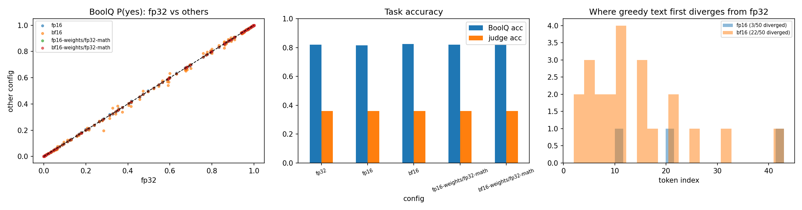

# BitsnPieces

**How much does the number format of an LLM matter?** A small, hands-on experiment that runs one model in different numeric precisions and observes what changes.

*Author: Dhaaivat Patil*

---

## Where this started

I wanted to understand, concretely rather than from blog posts, what "fp32 vs fp16 vs bf16" means for a language model:

- What is actually stored in those bits?
- Why are there two different 16-bit formats?
- Does a model get worse when you halve its precision?

The plan was deliberately simple:

- **One baseline model**, loaded in **FP32, FP16 and BF16**.
- **Two small annotated datasets:**
  - a **yes/no QA** set
  - a **generative QA** set
- **Simple observations** rather than a big benchmark: what changes in the weights, the outputs, the quality, the memory and the speed.
- **Free tools only:**
  - Kaggle (2× T4 GPUs)
  - Hugging Face for the model and datasets
  - a Gemini Flash model as an automatic judge for the generated answers

## What I wanted to achieve

1. Understand the **bit layouts**: sign, exponent and mantissa, and what range and precision each format gives.
2. See what happens to **real model weights** when they are cast between formats.
3. Separate two things that "running in fp16" mixes together:
   - **weight storage precision**: the format the weights are saved in
   - **compute precision**: the format the arithmetic runs in
4. Measure the effect on **task quality**, **output stability**, **memory** and **speed**.

## What I did

| Step | What | Details |
|---|---|---|
| A | **Bits by hand** | Printed numbers like 0.1, π, 70000 and 1e-8 as sign/exponent/mantissa bits in each format. |
| B | **Weight and activation analysis** | Rounded all 1.54 B weights to fp16 or bf16 and back, and counted the error, overflows, and values flushed to zero. Checked how close the activations get to fp16's 65,504 ceiling. |
| C | **5 configurations** | Three standard runs: `fp32`, `fp16`, `bf16`. Two controls that store the weights in 16 bits but compute in fp32: `fp16-weights/fp32-math`, `bf16-weights/fp32-math`. |
| | **Yes/no task** | BoolQ, 200 questions. Instead of generating text, I read the model's probability of answering "yes" vs "no", so I could compare probabilities and not just right/wrong. |
| | **Generative task** | TruthfulQA, 50 questions, greedy decoding. I recorded the token at which each run's text first differs from fp32. |
| D | **LLM judge** | `gemini-3.8-flash` graded every answer as correct or not. All 5 answers to a question went into one call, shuffled and unlabelled. |
| E | **Analysis** | Accuracy, agreement with fp32, KL divergence, memory, speed, plus a second full run to check reproducibility. |

- **Model:** `Qwen/Qwen2.5-1.5B-Instruct`
- **Hardware:** one Kaggle T4

## What I found

- **Storing the weights in 16 bits cost nothing.**
  - The model is *published* in bf16, so "fp32" is just bf16 padded with zero bits.
  - The bf16-storage control matched fp32 exactly, on 200 of 200 questions.
- **Every visible difference came from compute.**
  - bf16 arithmetic shifted the yes/no probabilities about 5x more than fp16 arithmetic.
  - bf16 changed the generated text on 22 of 50 answers, versus 3 of 50 for fp16.
- **Quality didn't change.**
  - Every judged question got the same score in all 5 configurations, even where the wording differed.
  - BoolQ accuracy stayed within one borderline question (0.815–0.825).
- **Memory halves:** 6.2 → 3.1 GB of weights.
- **Speed depends on the GPU, not just the bit count.**
  - fp16 was the fastest: 1.4–1.5x faster at generation and 4x faster on BoolQ.
  - bf16 was about half the speed of fp32, because the T4 has no native bf16 support.
- **The results reproduced across two independent runs.** The only differences were speed and one judge score.



The full write-up, with all tables, figures and per-question detail, is in **[docs/README.md](docs/README.md)**. Everything learnt along the way (concepts, design choices, and Kaggle, Hugging Face and Gemini issues) is logged in **[docs/LEARNINGS.md](docs/LEARNINGS.md)**.

## Repository layout

```
BitsnPieces/
├── README.md                          ← you are here
├── notebooks/
│   ├── precision_playground.ipynb     clean notebook to run on Kaggle
│   └── bitspiecesnprecision.ipynb     the executed Kaggle run, with outputs
├── docs/
│   ├── README.md                      full results report
│   ├── LEARNINGS.md                   running log of lessons learnt
│   ├── figures/                       plots
│   └── results/                       CSVs: summary, per-question, per-tensor, run config
└── results/                           raw Kaggle output download, untouched
```

## Reproducing it

1. Upload [`notebooks/precision_playground.ipynb`](notebooks/precision_playground.ipynb) to Kaggle.
2. Set the accelerator to **GPU T4 x2** (only one GPU is used) and turn **Internet on**.
3. Add two Kaggle secrets:
   - `HF_TOKEN` (Hugging Face)
   - `GEMINI_API_KEY` (Google AI Studio)
4. Use **Save Version → Save & Run All**. The results land in the notebook's Output, under `results/`.

A run takes well under an hour of GPU quota. The model, sample sizes, judge model and seed are set in the config cell.

## Roadmap

- [x] **Floating point:** FP32 vs FP16 vs BF16, with storage-only controls *(this commit)*
- [ ] **Integer quantization:** 8-bit and 4-bit (`bitsandbytes`) on the same model, tasks and metrics
- [ ] A model published in fp32, so weight-storage effects show up
- [ ] Shrinking the mantissa bit by bit, to find where weight rounding starts to hurt
- [ ] The same experiments on a bf16-capable GPU (L4 or A100)

## Use of AI assistance

This project was built with the help of an AI coding assistant, **Claude Code** (Anthropic). I came up with the idea and the goals, basic boilerplate code alongwith dataset selection.
Compiling, error debugging and making certain changes to the ipynb such that it runs on Kaggle, was mainly done with the help of **Claude Code** 

## Acknowledgements

- [Qwen2.5](https://huggingface.co/Qwen/Qwen2.5-1.5B-Instruct) by the Qwen team
- [BoolQ](https://huggingface.co/datasets/google/boolq) (Clark et al., 2019)
- [TruthfulQA](https://huggingface.co/datasets/truthfulqa/truthful_qa) (Lin et al., 2021)
- Compute provided by Kaggle
