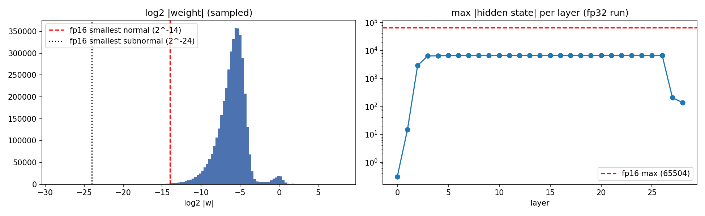
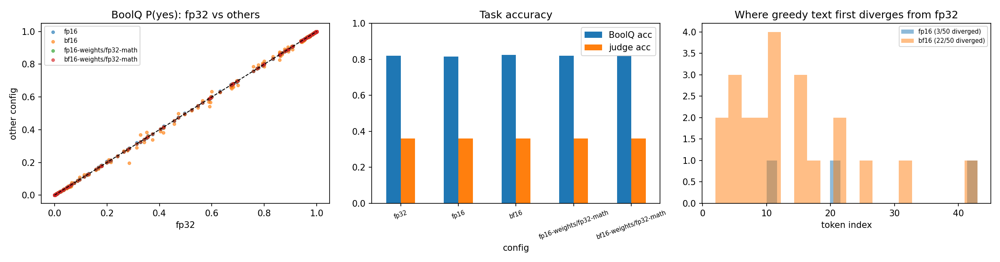

# BitsnPieces: FP32 vs FP16 vs BF16 on one LLM

**Question:** if the same model runs in different floating-point formats, what changes in its weights, outputs, quality, memory and speed?

**Short answer, for this model on a Kaggle T4:**

- **Storage:** storing the weights in 16 bits cost nothing. The model was published in bf16, so an "fp32" copy holds no extra information.
- **Compute:** running the arithmetic in 16 bits changed the outputs slightly. bf16 drifted about 5x more than fp16.
- **Quality:** unchanged. Every judged question got the same score in all 5 configs.
- **Memory and speed:** both 16-bit formats halved memory. fp16 was the fastest. bf16 was the slowest, because a T4 has no native bf16 support.

| | |
|---|---|
| Model | `Qwen/Qwen2.5-1.5B-Instruct` (1.54 B params, **published in bf16**), HF commit `989aa79` |
| Hardware | Kaggle, 1× Tesla T4 (compute capability 7.5), torch 2.11.0+cu130 |
| Yes/no task | BoolQ validation, 200 questions (57.5% "yes"), scored from next-token P(yes) vs P(no) |
| Generative task | TruthfulQA generation, 50 questions, greedy decoding, max 160 new tokens, batch 8, seed 0 |
| Judge | `gemini-3.8-flash`, one call per question, all 5 answers shuffled and unlabelled, 1/0 correctness |
| Runs | **Run 1:** interactive session ([`../notebooks/bitspiecesnprecision.ipynb`](../notebooks/bitspiecesnprecision.ipynb)). **Run 2:** Kaggle "Save Version", a full re-run that produced the files in [results/](results/). The numbers below are from run 2 unless marked. |
| Process log | [LEARNINGS.md](LEARNINGS.md): everything learnt while preparing this |

### Files

| file | contents |
|---|---|
| [results/summary.csv](results/summary.csv) | the main table (section 3) |
| [results/boolq_per_question.csv](results/boolq_per_question.csv) | 200 questions × P(yes) for each config, plus the correct answer |
| [results/generations.csv](results/generations.csv) | 50 questions × 5 configs: answer, judge score, first token that differs from fp32 |
| [results/weight_cast_summary.csv](results/weight_cast_summary.csv), [results/weight_cast_per_tensor.csv](results/weight_cast_per_tensor.csv) | Part B weight-rounding damage, overall and for each of the 338 tensors |
| [results/run_config.json](results/run_config.json) | run settings |
| [figures/](figures/) | the two plot figures |

The untouched Kaggle download is kept in [`../results/`](../results/).

---

## 1. The formats

| format | sign / exponent / mantissa | max | smallest normal | eps (gap after 1.0) | bytes/param |
|---|---|---|---|---|---|
| FP32 | 1 / 8 / 23 | 3.40e38 | 1.18e-38 | 1.19e-7 | 4 |
| FP16 | 1 / 5 / 10 | **65,504** | 6.10e-5 | 9.77e-4 | 2 |
| BF16 | 1 / 8 / 7 | 3.39e38 | 1.18e-38 | **7.81e-3** | 2 |

- **Exponent bits set the range.** fp16 has only 5, so it overflows past 65,504 and starts losing precision below 6.1e-5.
- **Mantissa bits set the precision.** bf16 has only 7, so its steps are 8x coarser than fp16's (eps 7.8e-3 vs 9.8e-4).
- **bf16 is simply fp32 with its last 16 bits removed.** It keeps the full fp32 range and gives up precision.

### What real numbers turn into (Part A of the notebook)

| x | fp32 | fp16 | bf16 |
|---|---|---|---|
| 0.1 | 0.1000000015 | 0.09997558594 | 0.1000976562 |
| 1/3 | 0.3333333433 | 0.3332519531 | 0.333984375 |
| π | 3.141592741 | 3.140625 | 3.140625 |
| 70000 | 70000 | **inf** (overflow) | 70144 |
| 1e-6 | 9.999999975e-07 | 1.013e-06 (subnormal) | 9.984e-07 |
| 1e-8 | 9.999999939e-09 | **0** (underflow) | 1.0012e-08 |

- fp16 fails at the **extremes** (70,000 and 1e-8).
- bf16 never fails on range, but it is coarse everywhere: 70,000 becomes 70,144.
- For π, both formats happen to round to the same value. The extra fp16 bits don't help with every number.

---

## 2. What happens to the weights (Part B)

Each fp32-loaded weight was rounded to fp16 or bf16 and back, and the damage was measured.

| over 1.54 B weights | fp16 | bf16 |
|---|---|---|
| weighted mean relative error | 4.9e-6 | **0 (exact)** |
| overflow → inf | 0 | 0 |
| non-zero → flushed to 0 | 2,700 (0.0002%) | 0 |
| became subnormal (less precise) | 2,975,168 (0.19%) | 0 |
| largest \|weight\| | 316 (well under 65,504) | – |

**Why bf16 is exact:** the checkpoint was *published* in bf16. Loading it "in fp32" only appends zero bits, and casting back to bf16 removes them again.

**Why fp16 is almost exact:** fp16 has more mantissa bits (10) than bf16 (7). So every bf16 value inside fp16's normal range, 6.1e-5 to 65,504, fits into fp16 exactly. The only losses are the tiniest weights, below 2⁻¹⁴: about 0.19% become subnormal and keep fewer bits, and 2,700 round to 0. The embedding matrix accounts for 1,452 of the 2,700 and 480,601 of the subnormals.

**Left, where the weights sit:**
- Most weights are around 2⁻⁶ ≈ 0.015, with a thin tail reaching fp16's subnormal boundary (red line).
- The small bump near 2⁰ is the norm-layer scales, which sit around 1.
- So weights comfortably fit in fp16.

**Right, the largest activation per layer** (the hidden state after each layer, one prompt, fp32 run):
- It plateaus around 6–7 × 10³ for layers 3–26.
- That is about **10x below fp16's 65,504 ceiling**. This headroom is why the fp16 run produced no inf or NaN values.
- Caveat: this is one prompt and only the residual stream. The values inside the MLP blocks were not measured.

---

## 3. Results across the 5 configs (Parts C–E)

`X-weights/fp32-math` are controls: the weights are rounded to X and stored, but every computation runs in fp32. They separate **storage** precision from **compute** precision.

| config | weights GB | peak GB | BoolQ acc | agree w/ fp32 | mean \|ΔP(yes)\| | KL vs fp32 | top-1 agree | gen identical to fp32 | median 1st diverging token | judge acc | gen tok/s (run 2 / run 1) | BoolQ time (run 1) |
|---|---|---|---|---|---|---|---|---|---|---|---|---|
| **fp32** | 6.17 | 6.92 | 0.820 | 1.000 | 0 | 0 | 1.000 | 100% | – | 0.36 | 73.9 / 73.9 | 40 s |
| **fp16** | 3.09 | 3.47 | 0.815 | 0.995 | 0.0011 | 3.3e-5 | 1.000 | 94% (3/50 diverged) | 21 | 0.36 | **109.3 / 103.9** | **9 s** |
| **bf16** | 3.09 | 3.58 | 0.825 | 0.995 | **0.0059** | **1.5e-3** | 0.985 | **56%** (22/50 diverged) | **11** | 0.36 (run 1: 0.34) | 38.5 / 36.7 | 70 s |
| fp16-weights/fp32-math | 6.17 | 6.92 | 0.820 | 1.000 | 1.1e-6 | ≈0 (-2.4e-9) | 1.000 | 100% | – | 0.36 | 71.6 / 68.8 | 50 s |
| bf16-weights/fp32-math | 6.17 | 6.92 | 0.820 | 1.000 | **0 (bit-exact)** | 0 | 1.000 | 100% | – | 0.36 | 71.9 / 68.9 | 50 s |

No config produced any NaN outputs.

### Per-question detail

**BoolQ** (from [boolq_per_question.csv](results/boolq_per_question.csv))

| config | P(yes) bit-identical to fp32 | largest single \|ΔP\| | answers flipped |
|---|---|---|---|
| fp16 | 0 / 200 | 0.0088 | 1 |
| bf16 | 0 / 200 | **0.089** | 1 |
| fp16-weights/fp32-math | 40 / 200 | ~1e-6 | 0 |
| bf16-weights/fp32-math | **200 / 200** | 0 | 0 |

- **Both flips were coin-tosses already.** fp32 put both questions within 0.03 of the 0.5 cut-off:
  - fp16: *"is in n out only located in california"* went 0.496 → 0.502, turning a correct "no" into a wrong "yes".
  - bf16: *"is a soccer stadium bigger than a football stadium"* went 0.473 → 0.50001, turning a wrong "no" into a correct "yes". This is why bf16's accuracy is *higher* (0.825): a flip that happened to land right, not better math.
- **bf16's largest shift** was on *"is there going to be a 3rd series of 800 words"*: 0.285 → 0.196. The decision stayed "no", but the confidence moved by 9 points. The other large bf16 shifts were all 3–5 points.

**Generation** (from [generations.csv](results/generations.csv))

- **Text diverged a lot under bf16 and little under fp16.**
  - bf16 diverged from fp32 on 22 of 50 answers, at tokens 2, 3, 5, 6, 6, 7, 8, 9, 10, 11, 11, 11, 12, 15, 16, 16, 17, 21, 22, 26, 32 and 43.
  - fp16 diverged on 3 answers, at tokens 10, 21 and 43.
- **Divergence never changed correctness.** In run 2, every one of the 50 questions got the same judge score in all 5 configs, including all 22 bf16 answers whose wording changed.
- **The judge was consistent within a run.** Identical answers to the same question never received different scores.
- **The judge varied between runs.** The generated text was identical in both runs, yet run 1 scored one bf16 answer as wrong (0.34) and run 2 scored it as right (0.36). So run 1's 2-point bf16 dip was judge noise, not a precision effect.

---

## 4. What we observed and why

**1. Storage precision cost nothing.**
- The bf16-storage control is bit-for-bit identical to fp32: all 200 P(yes) values match exactly. This follows from the checkpoint being bf16 (section 2).
- The fp16-storage control is *not* bit-identical: only 40 of 200 P(yes) values match exactly. The flushed and subnormal weights do change the numbers, but only at about 1e-6, which is far too small to change any answer or token.

**2. Every visible difference came from compute precision.**
- The full fp16 and bf16 runs do the arithmetic in 16 bits. Each operation's output is rounded back to 16 bits before the next layer uses it, so small errors build up across the 28 layers.

**3. bf16 math drifts about 5x more than fp16 math.**
- The P(yes) shift is 0.0059 vs 0.0011, the KL is about 44x larger (1.5e-3 vs 3.3e-5), and the largest single shift is about 10x larger (0.089 vs 0.0088). This follows from bf16's 8x coarser eps.
- bf16 changed the most-likely next token on 3 of 200 BoolQ prompts (top-1 agreement 98.5%). fp16 changed none.
- In the first scatter plot, the orange bf16 points spread around the diagonal while the fp16 points sit on it.

**4. fp16's range risk did not show up here.**
- Activations peaked about 10x below 65,504 and there were no NaNs.
- On another model, or on very long inputs, activations can exceed that ceiling. Then fp16 breaks (inf or NaN) while bf16 keeps working. That is why training uses bf16.

**5. Generated text diverges, but quality does not drop.**
- Greedy decoding always picks the single most likely token. When the top two candidates are nearly tied, a 1e-3 numeric difference flips the choice, and every later token follows from a different prefix.
- The divergent answers reworded the same claim. For example, bf16 said the Autobahn was built "from 1934 to 1940" instead of "during World War II": also wrong, just worded differently.
- In one example (the scientists question), fp16 and bf16 produced the *same* longer answer, while fp32 and the controls gave a shorter one. Two 16-bit runs can take the same alternative path at a near-tie.
- The BoolQ accuracy differences (0.815 / 0.82 / 0.825) are each one borderline question flipping.

**6. The results reproduce.** Run 2 matched run 1 on every precision metric and on every divergence point. The example answers I compared were word-for-word identical. The only differences were speed and one judge score. On a fixed GPU and software stack, precision effects are deterministic.

**7. Memory halves, as expected:** 6.17 → 3.09 GB of weights, and 6.92 → about 3.5 GB peak.

**8. Speed depends on the hardware, not just the bit count.**
- fp16 was 1.4–1.5x faster at generating (74 → 104–109 tok/s) and **4.4x faster on BoolQ** (40 s → 9 s). BoolQ processes long prompts in large matrix multiplications, which is where the T4's fp16 tensor cores help most.
- bf16 was about **half the speed of fp32** (37–39 tok/s, 70 s). The T4 (compute capability 7.5) has no native bf16 hardware; that needs 8.0 or newer (A100, H100, L4).
- Timing noise: the fp32 run and the controls do identical math, yet their speeds differ by up to about 7% (generation) and about 25% (BoolQ). The same config also varied about 5% between runs. Speed gaps smaller than that are not meaningful.

**9. The model itself is weak on TruthfulQA** (judge accuracy 0.36 in every format). That benchmark is designed to trap common misconceptions, and a 1.5 B model falls for many of them. Precision does not change that.

### One-line takeaways
- **Weights in bf16/fp16: free** for a bf16-published model, and it halves memory.
- **Math in fp16:** almost exact, and fastest on a T4. Risky only if activations exceed 65,504.
- **Math in bf16:** about 5x noisier than fp16, but answers and correctness held. Safe on range, but slow on a T4.
- **Identical output text is the wrong yardstick.** Use task accuracy or probability and KL comparisons. Also check whether the judge gives the same scores on a second run.

---

## 5. Limitations

- **Small samples.** At 200 + 50 questions, a gap of 1–2 questions is noise. No significance testing was done.
- **One model, one GPU type, one activation probe** (single prompt, residual stream only).
- **Weight storage was not really stressed.** The checkpoint is bf16-native, so the storage-only result is close to trivial. A model published in fp32 (e.g. `gpt2-medium`), or rounding to fewer than 7 mantissa bits, would show real storage effects.
- **One judge, slightly non-deterministic, no human check.** The same text got a different score between runs once, even at temperature 0.
- **BoolQ time was only recorded in run 1.** It appeared in the printed log but not in `summary.csv`.

## 6. Possible next steps

1. Repeat with a model published in fp32 (e.g. `gpt2-medium`), so weight-storage rounding has a real effect.
2. Round bf16 weights to 6, 5, 4… mantissa bits and find where BoolQ accuracy starts to fall.
3. Try int8 and 4-bit weights (`bitsandbytes`) as the next steps down.
4. Probe the MLP intermediate activations and long prompts, to find where fp16 overflow actually starts.
5. Run the same notebook on a bf16-capable GPU (L4, A100) to confirm the speed result reverses.
